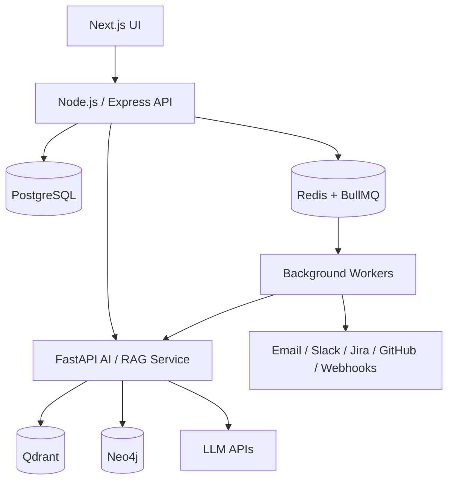

# Intellix

**AI-Powered Knowledge Intelligence & Automation Platform**

Intellix transforms organizational knowledge into secure, explainable and actionable workflows.

> **Knowledge → Context → Reasoning → Decision → Action**


---

## Status

Intellix is under active development, built incrementally in phases. This README separates what **works today** from what is **planned**, so nothing here is overstated.

| Phase | Scope | Status |
|---|---|---|
| 0 | Foundations: repo, Docker services, Node API, FastAPI service, health checks, CI | Done |
| 1 | Baseline RAG: parse, chunk, embed, store, retrieve, answer with citations | In progress |
| 2 | Retrieval quality: structure-aware chunking, BM25, hybrid search, reranking | Planned |
| 3 | Security: JWT, RBAC, tenants, permission-aware retrieval, leakage tests | Planned |
| 4 | GraphRAG: entity/relationship extraction, Neo4j, graph + vector retrieval | Planned |
| 5 | Optimization: semantic cache, version-aware invalidation, cost telemetry | Planned |
| 6 | Model routing: complexity classifier, provider selection, fallbacks | Planned |
| 7 | Change intelligence: version diff, impact analysis, stale-cache invalidation | Planned |
| 8 | Automation: domain events, BullMQ workers, email, Slack, GitHub/Jira, webhooks | Planned |
| 9 | Observability: latency, cost, cache, job and security dashboard | Planned |
| 10 | Evaluation: benchmark dataset, baseline vs improved comparisons | Planned |
| 11 | Deployment: production containers, CI/CD, live demo | Planned |

### Phase 1 detail

| Step | Description | Status |
|---|---|---|
| 1.1 | Provider setup (NVIDIA API: LLM + embeddings) | Done |
| 1.2 | Document parsing (PDF, DOCX, TXT, MD) with page numbers | Done |
| 1.3 | Fixed-size chunking with overlap | Done |
| 1.4 | Embeddings + Qdrant vector storage | Done |
| 1.5 | `/index` and `/search` endpoints | Done |
| 1.6 | `/ask` answer generation with citations | In progress |
| 1.7 | Node API upload/ask endpoints that call FastAPI | Planned |
| 1.8 | End-to-end test with a real document | Planned |

---

## Why Intellix

Most RAG demos stop at "chat with your PDF". Intellix targets the harder problems around it:

- Knowledge is fragmented across documents and systems.
- Plain vector search struggles with multi-hop, relationship-heavy questions.
- Access control fails if authorization happens *after* private content reaches the LLM.
- Repeated questions waste tokens, latency and budget.
- Document changes make previously generated answers stale.
- Answering a question is rarely the end goal; an action usually has to follow.

RAG is the intelligence layer, not the whole product. The differentiator is the full knowledge-to-action pipeline.

---

## Architecture

### Target architecture



### Two backends, on purpose

| Service | Stack | Responsibilities |
|---|---|---|
| **API** (`apps/api`) | Node.js, Express, TypeScript | Auth (JWT/RBAC), tenants, document metadata, integrations, automation rules, audit, webhooks |
| **RAG service** (`services/rag-service`) | Python, FastAPI | Parsing, chunking, embeddings, vector retrieval, answer generation, later BM25, reranking, GraphRAG, validation, evaluation |

The browser talks to Node. Node calls FastAPI for AI work. All Node-to-FastAPI calls go through one client module.

### Current RAG flow (implemented)

```
Upload  → parse → chunk → embed (passage) → Qdrant
Question → embed (query) → Qdrant top-k → prompt with numbered sources → LLM → answer + citations
```

---

## Tech stack

| Area | Technology | Status |
|---|---|---|
| Application API | Node.js 20+, Express, TypeScript, Zod | In use |
| AI/RAG service | Python 3.13, FastAPI, Pydantic | In use |
| Primary database | PostgreSQL 16 | Running (schema comes in Phase 3) |
| Vector database | Qdrant | In use |
| Cache / queue | Redis 7 (BullMQ later) | Running |
| LLM | `openai/gpt-oss-20b` via NVIDIA API (OpenAI-compatible) | In use |
| Embeddings | `nvidia/nemotron-3-embed-1b` (2048 dimensions) | In use |
| Infrastructure | Docker Compose | In use |
| CI | GitHub Actions | In use |
| Graph database | Neo4j | Phase 4 |
| Frontend | Next.js, TypeScript, Tailwind, Recharts | Later |

Model IDs are configurable in `.env`. Availability on the NVIDIA API changes over time, so verify IDs against your own key before relying on them.

---

## Project structure

```
Intellix/
├── apps/
│   ├── api/                  # Node.js / Express / TypeScript
│   └── web/                  # Next.js frontend (later)
├── services/
│   └── rag-service/          # FastAPI / Python
│       ├── app/
│       │   ├── routes/       # health, documents (index, search, ask)
│       │   └── services/     # parser, chunker, embeddings, vectorstore, llm, pipeline
│       └── scripts/          # connection, parser, chunker and index test scripts
├── infrastructure/docker/
├── evaluation/
│   ├── datasets/
│   └── reports/
├── docs/architecture/
├── .github/workflows/ci.yml
├── docker-compose.yml
├── .env.example
└── README.md
```

Workers, shared packages and more services are added in the phases that need them.

---

## Getting started (Windows / PowerShell)

### Prerequisites

- Git
- Node.js 20 or newer
- Python 3.13 (CI uses 3.13; match your local minor version)
- Docker Desktop
- An NVIDIA API key (build.nvidia.com)

### 1. Clone and configure

```powershell
git clone https://github.com/balaji206/Intellix.git
cd Intellix
Copy-Item .env.example .env
```

Edit `.env` and set a Postgres password and your `NVIDIA_API_KEY`. Never commit `.env`.

### 2. Start the databases

```powershell
docker compose up -d
docker compose ps
```

| Service | Host port |
|---|---|
| PostgreSQL | 5432 |
| Redis | 6379 |
| Qdrant (HTTP) | **6335** (mapped from 6333) |
| Qdrant (gRPC) | 6336 (mapped from 6334) |

Qdrant uses 6335/6336 on the host to avoid clashing with other local Qdrant instances. Keep `QDRANT_PORT=6335` in `.env`.

### 3. Run the Node API

```powershell
cd apps\api
npm install
npm run dev
```

Runs on `http://localhost:4000`.

### 4. Run the RAG service

```powershell
cd services\rag-service
python -m venv .venv
.\.venv\Scripts\Activate.ps1
pip install -r requirements.txt
uvicorn app.main:app --reload --port 8000
```

Runs on `http://localhost:8000`. Interactive API docs are at `http://localhost:8000/docs`.

### 5. Verify everything is connected

```powershell
Invoke-RestMethod http://localhost:4000/health/all | ConvertTo-Json -Depth 5
```

Expect `postgres`, `redis` and `ragService` all `ok`. The check reports `degraded` with a 503 if any dependency is down.

---

## Configuration

Copy `.env.example` to `.env` and fill in the values.

```env
# Postgres
POSTGRES_USER=intellix
POSTGRES_PASSWORD=change_me
POSTGRES_DB=intellix

# Services
API_PORT=4000
RAG_PORT=8000
RAG_SERVICE_URL=http://localhost:8000

# Qdrant (host port)
QDRANT_PORT=6335

# NVIDIA API (OpenAI-compatible)
NVIDIA_API_KEY=
NVIDIA_BASE_URL=https://integrate.api.nvidia.com/v1
LLM_MODEL=openai/gpt-oss-20b
EMBEDDING_MODEL=nvidia/nemotron-3-embed-1b
```

Notes:

- `gpt-oss-20b` is a reasoning model. It spends tokens thinking before it answers, so always give it a generous `max_tokens` (1000 or more) or the answer can come back empty.
- Changing the embedding model changes vector size and meaning. You must recreate the Qdrant collection and re-embed every document.

---

## API reference (RAG service)

| Method | Path | Purpose |
|---|---|---|
| GET | `/health` | Checks Qdrant and Redis connections |
| POST | `/index` | Upload a file (PDF, DOCX, TXT, MD): parse, chunk, embed, store |
| POST | `/search` | `{ "question": "...", "limit": 5 }` returns the closest chunks with score, filename and page |
| POST | `/ask` | Same input; returns a grounded answer with numbered citations (in progress) |

Node API:

| Method | Path | Purpose |
|---|---|---|
| GET | `/health` | Postgres and Redis |
| GET | `/health/all` | Postgres, Redis, and the RAG service (with its own details) |

Upload and ask routes in Node arrive in Step 1.7.

---

## Design principles

1. **Incremental.** Each phase ends with something working and testable.
2. **Security from the start.** Authorization happens before context reaches the LLM.
3. **Measured, not claimed.** Improvements are shown with a fixed evaluation set. No invented numbers.
4. **Adapters behind stable interfaces.** LLM, embeddings and integrations are swappable.
5. **Async for heavy work.** Expensive and non-interactive jobs go through queues.
6. **Honest health checks.** Checks test real connections and report `degraded` when something is down.
7. **Add technology only when it has a job.**

---

## Planned evaluation

Phase 10 compares baseline and improved variants on a fixed dataset, using Recall@K, Precision@K, MRR, answer correctness, citation accuracy, latency, token cost and permission-leakage pass rate:

| Experiment | Baseline | Improved |
|---|---|---|
| Retrieval | Vector only | Hybrid + reranking |
| Graph reasoning | Vector RAG | GraphRAG / hybrid |
| Chunking | Fixed-size | Structure-aware |
| Caching | No cache | Semantic cache |
| Routing | Single model | Complexity-aware |
| Security | Unfiltered | Permission-aware |
| Versioning | Static index | Change-aware |

Results will be published in `evaluation/reports/` once measured.

---

## Known limitations (current)

- Fixed-size chunking can separate a heading from its content.
- Scanned PDFs without a text layer are not supported (no OCR yet).
- Re-uploading a document adds duplicate vectors until versioning is built (Phase 7).
- No authentication or tenant isolation yet (Phase 3). Do not index sensitive data.
- Retrieval always returns the closest chunks even when none are relevant; the answer step is responsible for saying "not found".

---

## Contributing

This is currently a personal project. Use feature branches, keep commits focused, and make sure CI passes before merging.

## License

Private project. All rights reserved.
